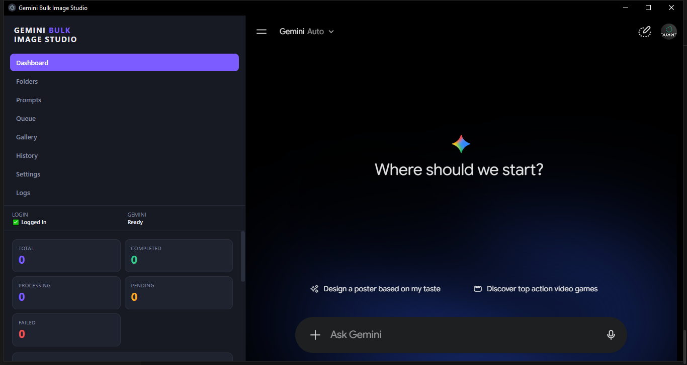

# Gemini Bulk Image Studio

Bulk image generation through the **real** Google Gemini website, packaged as a Windows desktop app.

The app embeds the live `https://gemini.google.com/app` page in its own session-partitioned
`WebContentsView`, lets you sign in to Google manually once, and then automates a strictly
sequential pipeline for every image in a folder:

```
upload image → type the saved master prompt → send → wait for generation
→ download the generated image → verify + convert to PNG → save with a _generated suffix
→ only then start the next image
```



*(Screenshot taken from the running application: the right-hand pane is the real
gemini.google.com page in its own persistent session, the left pane is the app dashboard.)*

## Requirements

- Windows 10/11 (x64)
- Node.js 20+ (development/build only — not needed for the installed `.exe`)
- A Google account with Gemini image-generation access

## Install (dev)

1. Extract the project folder.
2. Run `START.bat` (installs dependencies on first run, then launches the app).
3. Or manually:

```bat
npm install
npm start
```

`START.bat` first tries a normal launch. If the environment blocks Chromium's sandbox or the
default Windows profile folder, it automatically retries in development fallback mode (a local
profile under `data\dev-profile` with `--no-sandbox`). Normal desktop machines never hit the
fallback.

## Install (production)

1. Build the installer with `BUILD.bat` (or `npm run build`).
2. Run `dist\Gemini Bulk Image Studio Setup 2.0.0.exe`.
3. Launch **Gemini Bulk Image Studio** from the Start Menu.

The installer is per-user by default, allows choosing an install directory, and does not
require administrator rights. It is unsigned (no code-signing certificate), so SmartScreen may
show “More info → Run anyway”.

## First-time setup

1. **Sign in**: wait for Gemini to load in the right-hand panel and sign in to Google manually.
   The app never asks for, sees, or stores your Google password.
2. **Folders** → *Select Input Folder* (`.jpg`, `.jpeg`, `.png`, `.webp`).
3. **Prompts** → write your master prompt → *Save* → *Set Default*.
4. **Folders** → *Select Output Folder*.
5. **Dashboard** → **START**.

Progress, per-image state, retries, failures and ETA are visible live on the Dashboard; the
Queue, Gallery, History, Logs and Settings pages have the rest.

## How it works

| Layer | Responsibility |
|---|---|
| `src/main/main.js` | Electron bootstrap, `app://` renderer protocol, startup recovery, single-instance lock, fatal-startup reporting |
| `src/main/window-manager.js` | Main window + preload; IPC is registered before the renderer loads; denies renderer navigation/popups |
| `src/main/browser-manager.js` | Real Gemini in `persist:gemini-session` `WebContentsView`, login polling, Google-only popups, permission denial |
| `src/main/ipc-handlers.js` | Every IPC channel: validation, batch control, exports, diagnostics |
| `src/main/download-manager.js` | `blob:` / `https:` / `data:` downloads (page-context fetch first, `will-download` fallback) |
| `src/automation/gemini-adapter.js` | CDP (`webContents.debugger`) DOM automation: file chooser interception, prompt typing, send, new-image detection, CAPTCHA/limit detection, diagnostics |
| `src/automation/generation-engine.js` | Single-image-at-a-time state machine driver with retry taxonomy |
| `src/automation/selector-resolver.js` | Resolves fallback chains, fails loudly with `SELECTOR_NOT_FOUND` |
| `src/automation/state-machine.js` | Legal job transitions (FAILED can never become COMPLETED) |
| `src/automation/recovery-engine.js` | Resets crashed in-flight jobs to PENDING on startup |
| `src/database/*` | better-sqlite3 WAL database: batches, jobs, prompts, events |
| `src/services/*` | sharp thumbnails/PNG conversion, folder scanning, pino logging, settings, prompts |
| `src/renderer/*` | 8-page dashboard UI (ES modules over a privileged `app://` scheme), strictly `window.api` IPC bridge |

### Batch lifecycle

`batch:start` validates folders + default prompt + Gemini login, snapshots the master prompt
**verbatim** into the batch row, scans the input folder, creates PENDING jobs in SQLite, and
starts the engine without blocking the UI.

Job states: `PENDING → PREPARING → UPLOADING → UPLOADED → PROMPT_SUBMITTED → GENERATING →
GENERATED → DOWNLOADING → VERIFYING → COMPLETED`, with `FAILED`, `SKIPPED`, `PAUSED` handled
through the state machine. Each generated image is fetched from the page, converted to a real
PNG with sharp, verified, and only then is the job marked COMPLETED and the next job selected.

Output naming (never overwrites an existing file):

```
MA548.jpg  →  MA548_generated.png  →  MA548_generated_01.png  →  MA548_generated_02.png
```

### Prompt preservation

The default master prompt is read **once** at batch start, copied into the batch row, and used
verbatim for every image. Editing the prompt while a batch runs only affects the next batch.

### Crash recovery

On launch, jobs stuck in `PREPARING/UPLOADING/PROMPT_SUBMITTED/GENERATING/DOWNLOADING/VERIFYING`
are reset to `PENDING` ("Recovered from crash") and their batch becomes `interrupted`.
Pressing START or RESUME continues that batch instead of creating duplicates.

### Security

- UI renderer: `contextIsolation: true`, `nodeIntegration: false`; preload exposes only `window.api`.
- Gemini view: separate `persist:gemini-session` partition, `sandbox: true`, `contextIsolation: true`,
  `nodeIntegration: false`, **no preload**, all permission requests denied.
- Popups: only Google domains are allowed (OAuth); everything else is blocked.
- File paths arriving over IPC are resolved and validated; ZIP/CSV exports only read paths from
  the database (never renderer-supplied filesystem paths).
- Logs use pino with redaction and never include `Cookie` / `Authorization` headers.
- No Google password field exists anywhere; the profile never leaves the machine.
- Nothing secret is kept in the project folder: the Google session lives in the user profile
  (`%APPDATA%\gemini-bulk-image-studio`) and is excluded from builds.

## Verification

Automated suites live in `tools/`. They run against the real Electron binary and native modules.

```bat
:: backend: SQLite, repos, state machine, sharp, recovery, sequential engine (simulated Gemini adapter)
node_modules\electron\dist\electron.exe --no-sandbox tools\testapp

:: UI end-to-end over CDP (main.js enables --remote-debugging-port=9222)
node tools\ui-test.mjs phase1    :: full UI + IPC + thumbnails + navigation
node tools\ui-test.mjs phase2    :: restart the app first; proves persistence

:: packaged app sanity: every bare require() in app.asar must resolve
node tools\check-asar.mjs
```

Verified on this build (Windows 10 x64, Electron 32.3.3):

| Suite | Result | Covers |
|---|---|---|
| Backend tests | **32/32 passed** | migrations, repos, state machine, recovery, scanning, thumbnails, PNG conversion, settings validation, selector resolution, and a simulated 3-image batch |
| UI tests, dev build | **45/45 passed** | real Gemini target, 8 pages, 5 dashboard cards + 6 controls, IPC round trips, thumbnails, isolation, no console errors |
| UI tests, **packaged** build | **45/45 passed** | same suite against `dist\win-unpacked` (asar, native modules, sharp) |
| Restart persistence, dev + packaged | **6/6 each** | prompt, default flag, settings, queue and history survive a real restart |
| Installer | **Built** | `dist\Gemini Bulk Image Studio Setup 2.0.0.exe` (91.8 MB) |
The simulated batch test proves the hard rules without a live Google session: images are
processed strictly one at a time, the next upload starts only after the previous job is
COMPLETED, output names use `_generated` with `_01` collisions, the saved file is a verified
PNG, an existing output is never overwritten, and a failing job ends as FAILED (never COMPLETED)
after its retries.

Checklist notes (AGENT.md Section 13):

- **T01/T03** — verified: the packaged app shows the real Gemini page in its own
  `WebContentsView`, and the `persist:gemini-session` login survived many app restarts
  (screenshot shows “Logged In / Ready”).
- **T04/T05/T22/T23/T26** — verified by the automated suites.
- **T06–T11, T15–T19** — verified with the simulated Gemini adapter at the engine level and
  through the real database/state machine. A live generation against a signed-in Google account
  was **not** executed during this build (no credentials were used).
- **T02** — manual Google sign-in is the design; the app detects and displays the login state.
- **T12/T13/T14/T20/T21** — implemented and validated in code/state-machine tests; not covered
  by a live-batch automated test.
- **T24/T25** — CSV/ZIP export implemented; they open the native save dialog, so they were not
  driven by the automated suite (ZIP uses `archiver`, which is verified to load in the packaged app).

## Build

```bat
BUILD.bat
:: or
npm install
npm run build
```

Output: `dist\Gemini Bulk Image Studio Setup 2.0.0.exe` (NSIS, x64). The app icon is generated by
`tools/make_icon.py` into `assets/icons/app.ico`.

Packaging notes:

- electron-builder 25 can mis-place some **hoisted** transitive packages when collecting
  dependencies (it nested `archiver-utils` where the sibling `zip-stream` could not resolve it).
  `archiver-utils` and `color-convert` are declared as direct dependencies in `package.json` to
  guarantee they are packaged at the top level. `tools/check-asar.mjs` validates the result.
- `BUILD.bat` points `TEMP`/`TMP` at `.cache\temp` because NSIS may fail to create temporary
  files in a locked-down default temp folder.
- If the build fails while extracting `winCodeSign` with “Cannot create symbolic link”, enable
  Windows Developer Mode or run `BUILD.bat` as Administrator once (electron-builder needs symlink
  privileges for that helper archive).

## Configuration

`config/app.config.json` (also editable in the Settings page):

| Key | Default | Meaning |
|---|---|---|
| `maxRetries` | 3 | generic retry ceiling |
| `generationTimeoutMs` | 180000 | max wait for a new generated image |
| `downloadTimeoutMs` | 60000 | per-image download timeout |
| `uploadTimeoutMs` | 45000 | upload/attachment timeout |
| `includeSubfolders` | false | scan nested input folders |
| `outputFilenameFormat` | `{base}_generated{ext}` | must contain `{base}`; extension becomes `.png` |
| `duplicateHandling` | `rename` | fixed — completed outputs are never overwritten |
| `confirmBeforeBatch` | true | START asks for confirmation |
| `pauseAfterError` | true | pause on login/CAPTCHA/generation-timeout errors |
| `timeBetweenJobsMs` | 2500 | cool-down between images |
| `newChatPerJob` | true | open a fresh Gemini chat before each image |
| `startWithWindows` | false | stored only; autostart is not installed by this build |

`config/selectors.json` holds **every** Gemini DOM selector as ordered fallback chains
(including a `:has-text("...")` helper). No Gemini selectors are hardcoded in JavaScript. If
Gemini's layout changes, edit this file only — then run **Logs → Diagnostics** to see which keys
resolve against the live page.

## Troubleshooting

- **"Selector not found" / "Gemini layout changed"** → open Logs → Diagnostics and update
  `config/selectors.json` for the keys marked missing.
- **"Sign in required"** → complete Google sign-in in the right-hand Gemini panel; the status
  bar shows the current login state.
- **"Generation timeout"** → Gemini may be slow or the account/model may not generate images;
  increase `generationTimeoutMs` in Settings or verify manually in the panel.
- **"The image did not finish attaching"** → the upload was rejected; check file size/type
  manually in the panel and retry.
- **Output file empty** → Gemini returned an error card; check the Gemini panel.
- **App window does not open in a restricted environment** → run `START.bat`, which retries with
  `--no-sandbox` and a local profile. For the packaged app, the normal per-user profile is used.
- **A fatal startup problem** is written to `%APPDATA%\gemini-bulk-image-studio\startup-error.log`
  and shown in a dialog, instead of silently closing.

## Known limitations

- **Selectors are best-effort.** They were not verified against a signed-in live generation
  session during this build. The page itself loads (see screenshot) and diagnostics/fallback
  chains are in place, but Google changes the Gemini DOM frequently — expect to tune
  `config/selectors.json` if the layout moves.
- **Live generation end-to-end was validated with a simulated Gemini adapter**, not with a real
  signed-in Google account. Everything around it (real Gemini WebContentsView, login detection,
  upload/download plumbing, database, state machine, UI) was verified against the real app.
- **CAPTCHA / MFA are never bypassed.** The batch pauses with a banner; solve it manually and
  press RESUME.
- **Gallery lightbox uses the cached 120×120 thumbnail** (full images stay on disk and can be
  opened via *Reveal* in Explorer) to keep renderer memory low.
- **`startWithWindows` is not applied** (stored preference only).
- **`newChatPerJob`** prefers Gemini's “New chat” selector and falls back to reloading
  `gemini.google.com/app`; both keep per-image context isolated.
- **Downloads always produce PNG.** Whatever format Gemini returns is converted with sharp so the
  output file is guaranteed to be a valid `.png`.
- **The Gemini panel is a native `WebContentsView` overlay**, so it is not part of the app
  renderer's DOM (by design, and the reason iframes are not used).
- **`node tools/check-asar.mjs` reports a few unresolved optional/dev-only requires** (e.g.
  `re2`, `@img/sharp-wasm32`, benchmark/test helpers). They are guarded by `try/catch` or are
  never loaded; the packaged app’s automated suite passes. `color-convert` (needed only by
  `ansi-styles`, which is not used at runtime) is the one hoisted package that still packages
  nested; it is never required by the running app.
- Automation of a website may violate Google's Terms of Service. Use responsibly and only with
  content you have the right to process.
- Test hooks `GBS_USER_DATA_DIR` and `GBS_DISABLE_SINGLE_INSTANCE` exist only to make automated
  tests possible in sandboxed environments; normal launches need neither.

## Project layout

```
AGENT.md                 original build specification
package.json             scripts, dependencies, electron-builder config
START.bat / BUILD.bat    dev launcher / installer build
config/                  selectors.json, app.config.json
assets/icons/            generated app.ico / app.png
src/main/                Electron bootstrap, window, Gemini view, downloads, IPC
src/preload/preload.js   window.api bridge
src/renderer/            UI shell + 8 pages + styles
src/automation/          CDP adapter, selector resolver, generation engine, state machine, recovery
src/database/            SQLite bootstrap, migration, repositories
src/services/            image/file/prompt/settings/logging services
tools/                   test suites, asar checker, icon generator, screenshot helper
docs/                    README screenshot
data/                    runtime data when using START.bat fallback (gitignored)
```

Build artifacts and local runtime data (`node_modules/`, `dist/`, `.cache/`, `data/`) are
gitignored. `.cache/` also holds the local Electron/build caches used to rebuild offline; it can
be deleted safely.
